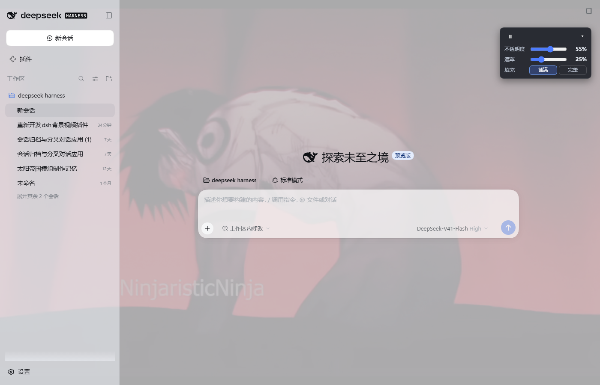
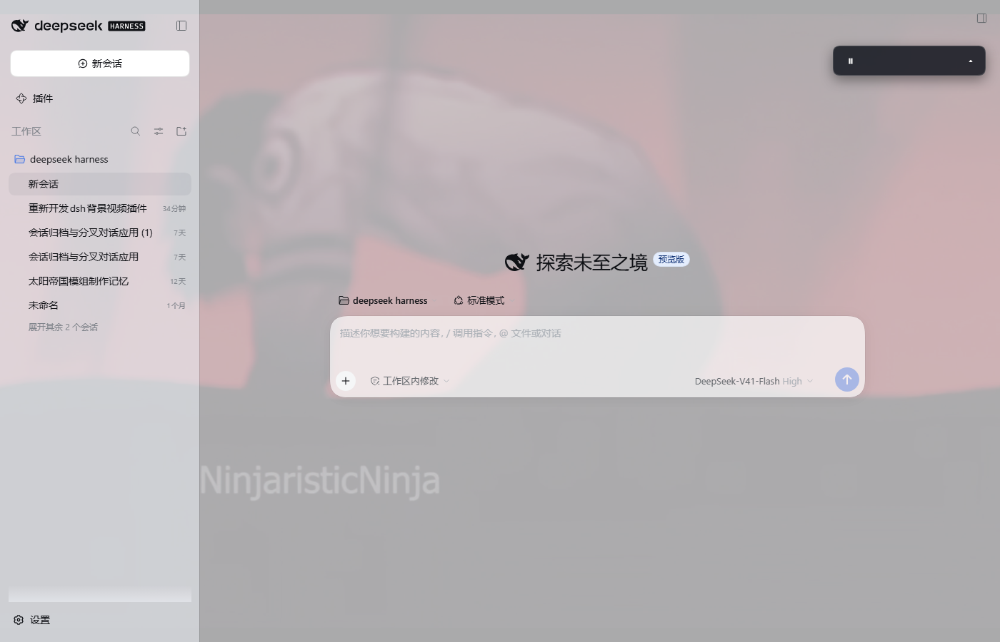

# dsh-video-bg

> **真没想到你能做到这一步啊！领域展开——【无量空处】**

English | [中文](README.zh.md)

Loop a local video as the background of the DeepSeek Harness chat UI — on the
plain Web surface (`dsh web`) and inside DSH Desktop, which renders the same web
app. The panels become translucent so the video shows through, while chat
bubbles and the composer stay readable.



## Features

- **Background video**: a fixed, full-viewport `<video>` painted at `z-index: -1`
  and streamed from the host over HTTP, so a multi-hundred-MB file plays without
  ever being uploaded. HTTP Range (`206`/`416`) support lets the browser seek and
  read ahead.
- **Translucent UI**: the shell's design tokens (`--dsw-alias-bg-base`,
  `--dsw-specific-sidebar-fill`, `--dsw-specific-input-major`, …) are remapped to
  semi-transparent colors for both light and dark themes, so every surface that
  uses a token becomes translucent automatically. Chat bubbles and the composer
  keep near-opaque fills.
- **Floating control** (top-right): play/pause, video opacity, dark scrim for
  contrast, fit (`cover`/`contain`), and collapse. Choices persist in
  `localStorage` (`dsh.videoBg.v3`); the video pauses when the window is hidden.
- **Clear failures**: a missing or unreadable file shows a warning badge and a
  console diagnostic instead of silently doing nothing.
- **Local only**: video bytes never leave the machine. The plugin registers two
  loopback HTTP routes on the existing DSH web server; no external service, no
  telemetry.



## Requirements

- DeepSeek Harness **0.2.x** (`engines.dsh` in `package.json`), Web or Desktop.
  The bundle is validated against the installed runtime before it loads.
- Node 20+ (the host half only uses `node:fs`, `node:path`, `node:url`).
- A video file readable by the **host** process (not the browser). MP4/WebM/MOV/
  MKV/AVI/OGG/TS are recognized; anything else is served as `video/mp4`.

## Install

The package is a normal DSH bundle, so any of these work:

```sh
# From GitHub (plain JavaScript — no build step, no build-script approval)
dsh plugin --profile desktop add github:zhang-guangjie/dsh-video-bg
dsh plugin --profile web add github:zhang-guangjie/dsh-video-bg

# From a local checkout (useful while developing)
dsh plugin --profile desktop add link:/absolute/path/to/dsh-video-bg

# From npm, once published
dsh plugin --profile desktop add dsh-video-bg
```

You can also install it from the GUI's plugin manager (Plugins → install /
browse). Installing a bundle selects it in `dsh.profile.bundles` automatically —
do not add the row by hand.

**Desktop note:** with the shipped profile, a newly installed bundle is applied
live (the running composition recomposes and the page receives the new client
entry). If your profile is startup-only, fully quit and restart DSH Desktop once.

## Configure the video

Resolution order for the file:

1. plugin row config `videoPath`;
2. environment variable `DSH_VIDEO_BG_PATH`;
3. the bundled `media/background.mp4` (a small default clip).

Set `videoPath` in your profile's own patch layer
(`$DSH_HOME/profiles/<profile>/cordis.patch.yml`):

```yaml
- id: ui-video-bg
  config:
    videoPath: 'D:\my-video.mp4'   # any local path; ~ is expanded
    fit: cover                     # cover | contain
    opacity: 55                    # initial video opacity, 0-100
    veil: 25                       # initial scrim, 0-100
```

- `videoPath` and `fit` are read by the host; `opacity`/`veil` are only defaults
  for a browser that has no saved slider values yet (the control's own values win
  afterwards).
- The row id is `ui-video-bg`; changing the config hot-reloads the plugin when
  HMR is enabled.
- Environment alternative: set `DSH_VIDEO_BG_PATH` before starting DSH.

## Using it

The floating control at the top-right has:

| Control | Effect |
|---|---|
| ▶ / ⏸ | Pause / resume the background video |
| 不透明度 / Opacity | Video opacity (0–100%), persisted |
| 遮罩 / Scrim | Dark veil between video and UI (0–100%), persisted |
| 填充 / Fit | `cover` (fill the window) or `contain` (show the whole frame) |
| ▴ / ▾ | Collapse / expand the settings panel |

The badge next to the toggle reports buffering and file errors. A missing file is
also reported by `GET /video-bg/status` and logged by the host.

## How it works

- **Host half** (`lib/index.js`, exported from the package root) declares
  `inject = ['webServer']` and registers a prefix route:
  - `GET/HEAD /video-bg/media` — streams the configured file with single-range
    support and a revision-based cache key (`?v=<size>-<mtime>`), so a changed
    file is fetched again instead of served from a stale media cache.
  - `GET /video-bg/status` — JSON with `ok`, `rev`, `size`, `mime`, the effective
    path/source and the configured defaults.
- **Client half** (`lib/client.js`, exported as `./client`) is a lazy
  `window.__ModuleLoader__.load({ id, factory })` bundle. `apply(ctx)` mounts
  everything inside `ctx.effect(...)`, so disabling the plugin or hot-replacing it
  removes the attribute, styles, video, scrim and control.
- **Both surfaces**: the browser requests the routes same-origin; DSH Desktop
  serves the document from `dsh-app://app/` and forwards every other path to the
  same authenticated loopback host, so both work unchanged. All URLs in the
  client are document-relative (`video-bg/media`), never absolute.

## Privacy and security

- The video is read by the host process and served **only** on the loopback web
  server that DSH already runs for the GUI. Nothing is uploaded, and the plugin
  makes no outbound requests.
- No credentials, cookies, or environment values are read or exposed. The status
  endpoint reveals the local path of the configured video, which the GUI already
  shows in the control tooltip.
- `videoPath` is configuration, not user input: treat the profile patch as
  trusted configuration, like any other DSH row config.

## Compatibility and market metadata

- `dsh.bundle.patch` → `cordis.patch.yml` inserts the `ui-video-bg` row.
- `dsh.client.platform: "web"` + `exports["./client"]` → served by the client
  module system.
- `engines.dsh` and `peerDependencies` gate the bundle to the matching DSH
  runtime; the host half imports no `@deepseek-ai/*` package, it only consumes the
  injected `webServer` service.
- Display metadata lives in `locale/en.json` / `locale/zh.json`, the icon in
  `assets/icon.svg`, and the storefront screenshots in `screenshots.json`.
- No build step is required, so GitHub installs need no `allowBuilds` approval.

## Troubleshooting

| Symptom | Check |
|---|---|
| Warning badge, no video | `GET /video-bg/status` — `error: "missing"`/`"unreadable"` names the cause; fix `videoPath` |
| Video plays but is barely visible | raise opacity, lower the scrim, or pick `contain`/a brighter clip |
| Another skin/plugin covers the video | skins that hardcode opaque surfaces can out-paint the token remap; disable the skin or the other plugin |
| Just installed, nothing appears | the profile may be startup-only — fully restart DSH; on Web reload the page |
| Large file takes a moment to start | the browser fetches the first ranges from disk; the rest streams with range requests |

## Development

```sh
# syntax check (plain JavaScript, no build)
node --check lib/index.js
node --check lib/client.js

# install into a test profile and boot the Web surface on a spare port
dsh plugin --profile mytest add link:/absolute/path/to/dsh-video-bg
dsh --profile mytest --no-open --port 0
```

The host and client contracts are documented in the official DSH references for
client modules and the web server; this package intentionally has no runtime
dependencies.

## License

MIT
